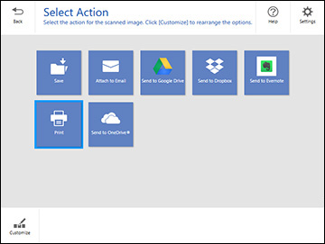
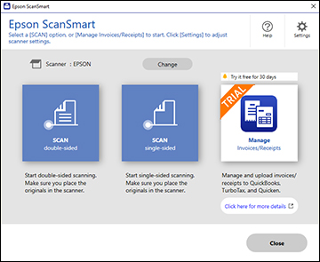
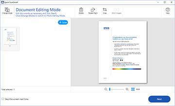

# Epson ScanSmart Turns Paper into Findable Documents

A scan is useful when its pages are complete, its name is recognizable, and its contents can be found again.
Epson ScanSmart brings scanning, page review, and saving or sending into a guided desktop workflow for supported Epson devices.

## Choose What the Next Reader Needs

Select the result according to the next task.
A document that looks correct on screen is not necessarily searchable or editable.
Check the saved file rather than assuming that every PDF includes recognized text.

| Next task | Output decision |
| --- | --- |
| Read and preserve the page image | Save a suitable image or PDF |
| Search for a phrase in the document | Choose Searchable PDF and its OCR language |
| Revise a letter or report | Use a supported editable Office export |
| Review receipt fields for accounting | Use the appropriate Invoice/Receipt Manager workflow |

Epson's [saving instructions](https://files.support.epson.com/docid/cpd6/cpd63364/source/spcs/source/scanners/source/scanning_software/tasks/epson_scansmart/scanning_scansmart_save.html) describe selecting Searchable PDF and the recognition language.
Open a completed file, search for a distinctive phrase, and compare the match with the page image.
For names, dates, and identifiers, inspect the actual recognized characters.

### Add searchability to an existing image-only PDF

With OCRmyPDF and English language data installed, this example processes an existing scanned PDF.
Use a new output filename and keep the original.

```bash
ocrmypdf -l eng --rotate-pages --deskew --output-type pdf "image-only.pdf" "searchable-copy.pdf"
```

The [OCRmyPDF cookbook](https://ocrmypdf.readthedocs.io/en/latest/cookbook.html) distinguishes page rotation from straightening a slightly crooked page.
Review both the appearance and the text after processing.
This operation does not turn the document into an editable Office layout.

Tesseract's supplied [pdf](tessdata/configs/pdf) and [txt](tessdata/configs/txt) configurations select different output renderers.
Its [renderer.h](include/tesseract/renderer.h) describes the rendering interface.
These references help distinguish a document image, recognized text, and a searchable container.

[](https://scansmart-software.github.io/Epson-Scansmart/)

## Assemble the Document While Every Page Is Visible

Keep the review screen in the workflow for a mixed or important batch.
Compare the digital sequence with the originals.
Correct missing, repeated, rotated, or misplaced pages before saving the collection.



The [document-scanning guide](https://files.support.epson.com/docid/cpd6/cpd63364/source/spcs/source/scanners/source/scanning_software/tasks/epson_scansmart/esc220_c320w_rr400w/scanning_scansmart_document_esc320w_rr400w.html) describes adding scans, deleting pages, rotating, cropping, and reviewing page order.
Available controls depend on the product model and software version.
A duplex option also depends on the scanning arrangement actually used.

For a contract or application packet, check:

1. The first and last page.
2. The order of numbered pages.
3. Whether attachments belong in the same file.
4. Whether a page back contains meaningful information.
5. Whether cropping retained signatures and page numbers.

Do not discard every nearly blank reverse side automatically.
A small note, stamp, or signature can matter even when most of the page is empty.
Review the result at a readable size.

In OCR software, page structure is distinct from recognized words.
Tesseract's [pageiterator.h](include/tesseract/pageiterator.h) exposes page-layout traversal.
[publictypes.h](include/tesseract/publictypes.h) defines shared types, while [osdetect.h](include/tesseract/osdetect.h) concerns orientation and script detection.

## Give Recognition a Readable Original

Choose the recognition language that matches the document.
Check orientation, contrast, and the visibility of small print before expecting reliable text.
Changing the output format cannot recover characters that the scan never captured clearly.



Use a recognizable sample containing:

- A person's name.
- An address or reference number.
- A date.
- A decimal value.
- A line with punctuation or accented characters.

Searchable text can be useful while still containing mistakes.
Compare the fields that will be copied into another system.
An apparently plausible replacement character can be harder to notice than a missing word.

### Produce text and word-level data with Tesseract

With Tesseract and its English model installed, this example processes an existing receipt image.
Choose an unused output base name.

```bash
tesseract "receipt-page.png" "receipt-check" -l eng txt tsv
```

The [Tesseract command-line guide](https://tesseract-ocr.github.io/tessdoc/Command-Line-Usage.html) documents language selection and TSV output.
The command requests plain text and tab-separated recognition information.
Retain the source image for comparison with both outputs.

Tesseract's [hocr](tessdata/configs/hocr), [tsv](tessdata/configs/tsv), [alto](tessdata/configs/alto), and [page](tessdata/configs/page) configurations request different structured outputs.
Its C++ API is declared in [baseapi.h](include/tesseract/baseapi.h), with a C interface in [capi.h](include/tesseract/capi.h).
Recognized-result traversal is represented by [resultiterator.h](include/tesseract/resultiterator.h) and [ltrresultiterator.h](include/tesseract/ltrresultiterator.h).

The supplied [eng.user-words](tessdata/eng.user-words) and [eng.user-patterns](tessdata/eng.user-patterns) are example recognition-support files.
[digits](tessdata/configs/digits) restricts the character set, while [bigram](tessdata/configs/bigram) changes word-correction settings.
[api_config](tessdata/configs/api_config) sets a recognition parameter.
These settings have specific engine purposes; they are not a universal remedy for an unclear scan.

## Name the File Before Sending It Elsewhere

Epson ScanSmart can use OCR to suggest a document subject and date.
Review those suggestions when the page contains several dates or a prominent unrelated heading.
Keep a fallback name that remains useful when recognition cannot identify the subject.

The [file-name settings guide](https://files.support.epson.com/docid/cpd5/cpd56105/source/scanners/source/scanning_software/tasks/epson_scansmart/es50_es65wr/changing_file_name_settings_es50_es65wr.html) describes automatic naming, OCR language, and date format.
Use one consistent convention for a collection.
Separate the document's issue date from the day it was scanned when that distinction matters.

For an **epson scan smart** collection, a useful name identifies the subject and relevant date.
For a **scansmart epson** workflow shared by several people, agree on the destination and naming convention.
A recognizable filename helps when the recipient cannot search inside the attachment.

### Keep a local result when using a cloud action

The [cloud-send instructions](https://files.support.epson.com/docid/cpd6/cpd63364/source/spcs/source/scanners/source/scanning_software/tasks/epson_scansmart/scanning_scansmart_cloud.html) describe account sign-in, destination selection, and an option to retain a computer copy.
Internet access and any requested account authorization are part of that route.
The available service actions should be checked in the installed application.

After sending, open the destination and verify the actual file.
Check that it belongs to the intended account and folder.
A completed scan preview alone does not establish that the cloud transfer succeeded.

Keep the paper until the saved or sent version meets the task.
For a document with attachments, confirm that the recipient has the complete packet.
Use the local copy to distinguish a scanning problem from a later sharing problem.

## Separate Editable Documents from Receipt Data

Epson documents [Office-format export](https://files.support.epson.com/docid/cpd6/cpd63364/source/spcs/source/scanners/source/scanning_software/tasks/epson_scansmart/scanning_scansmart_office.html) to Word, Excel, and PowerPoint.
The checked guide identifies PowerPoint saving as Windows-only and notes that an Office plug-in may be requested.
Confirm the actions available for the specific model and installed software.

An editable spreadsheet is not automatically a verified accounting record.
Check headings, columns, merged cells, numbers, and reading order after conversion.
Keep the page image as the reference when correcting the result.



The [Accounting Edition upgrade](https://epson.com/Accessories/Scanner-Accessories/Epson-ScanSmart-Software-Accounting-Edition-Upgrade-License/p/ESSAE0001) applies to selected scanners and adds receipt and invoice data workflows.
Check model, region, and license eligibility before expecting those actions in the standard application.
Review extracted values before exporting them to another program.

### Flag uncertain words in a separate OCR sample

The TSV produced by the earlier Tesseract command can help prioritize manual review.
This Python example prints word-level results below an illustrative confidence threshold.

```python
import csv

with open("receipt-check.tsv", newline="", encoding="utf-8") as source:
    for word in csv.DictReader(source, delimiter="\t"):
        if word["level"] == "5" and word["text"].strip():
            confidence = float(word["conf"])
            if 0 <= confidence < 80:
                print(word["text"], word["conf"])
```

The threshold is a review aid, not a probability that a word is correct.
Check important totals and identifiers even when their confidence is high.
This TSV is separate from an Invoice/Receipt Manager accounting export.

Epson's [CSV export instructions](https://files.support.epson.com/docid/cpd6/cpd63180/source/spcs/source/scanners/source/scanning_software/tasks/epson_scansmart/saving_receipts_csv.html) require a new filename or folder location for each export.
For a computer change, the [database backup guide](https://files.support.epson.com/docid/cpd6/cpd63180/source/spcs/source/scanners/source/scanning_software/tasks/epson_scansmart/exporting_receipt_database.html) calls for matching ScanSmart versions and warns that importing overwrites the current database.
Preserve the existing database before deciding which exported database to import.

Tesseract's [wordstrbox](tessdata/configs/wordstrbox) selects another recognition-output form.
It illustrates why word annotations, plain text, and application-specific accounting fields should remain distinguishable.

## Locate a Failure in the Correct Layer

For **epson scansmart software**, begin with the exact scanner model and operating system.
Epson's [support page](https://epson.com/support/epson-scansmart-downloads) directs users to model-specific downloads and utilities.
A model number appearing in a search suggestion does not establish ScanSmart compatibility.

If the device is not detected, check its connection and the software recommended for that model.
If pages scan but search fails, review the chosen output and OCR language.
If a cloud action fails, check the account and destination after confirming a local save.

For a **ScanSmart Software** report, record the model, operating system, application version, selected action, and the point of failure.
Keep a small representative sample when text recognition is the issue.
Distinguish unreadable input from incorrect recognition or a missing searchable layer.

Tesseract's [quiet](tessdata/configs/quiet) and [logfile](tessdata/configs/logfile) configurations control diagnostic output.
[get.images](tessdata/configs/get.images) requests processed images, and [segdemo](tessdata/tessconfigs/segdemo) contains segmentation-debug settings.
These are references for engine investigation rather than routine ScanSmart user settings.

Its ScrollView debugging components include [ScrollView.java](java/com/google/scrollview/ScrollView.java) and [SVWindow.java](java/com/google/scrollview/ui/SVWindow.java).
[SVImageHandler.java](java/com/google/scrollview/ui/SVImageHandler.java) handles image messages, and [SVEvent.java](java/com/google/scrollview/events/SVEvent.java) represents events.
They concern the OCR project's debugging interface.

## Related Search Terms

ScanSmart Software, Epson Scansmart, epson scan smart, scansmart epson, epson scansmart software, scanner, ocr, pdf, scanned-documents, image-processing, digitalization, tesseract, ocr-engine, twain, wia
